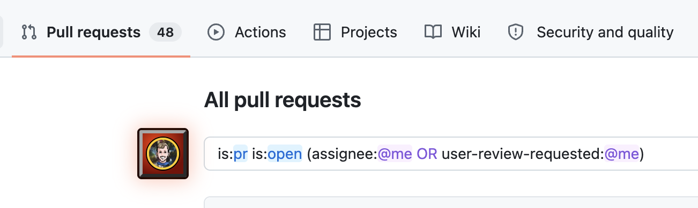
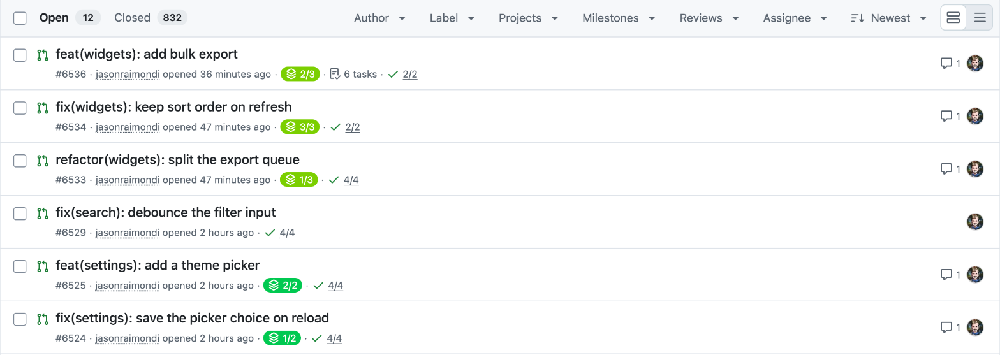

# GitHub for Jason

A personal Chrome extension that tweaks github.com.

- **My PRs filter**: on enabled repos, the pull request list opens filtered to open PRs you authored, are assigned to, or are asked to review. An avatar button beside the search box toggles back to GitHub's default list.
- **Stack colors**: in any repo's pull request list, each stacked PR's stack badge (icon and `1/2` count) becomes a colored pill. PRs in the same stack share a color, and different stacks on the page get different colors.





## Install

1. Open `chrome://extensions` and turn on Developer mode.
2. Click **Load unpacked** and choose this folder.
3. Right-click the extension → **Options**, and add the owners (`jasonraimondi`) or repos (`jasonraimondi/github-for-jason`) where the filter applies, one per line.

## Develop

There is no build step; Chrome loads the files as they are. After editing, reload the extension in `chrome://extensions`.

```sh
pnpm install
pnpm typecheck
```

The stack color palette is `STACK_COLORS` in `pulls.js`; any CSS color works.
